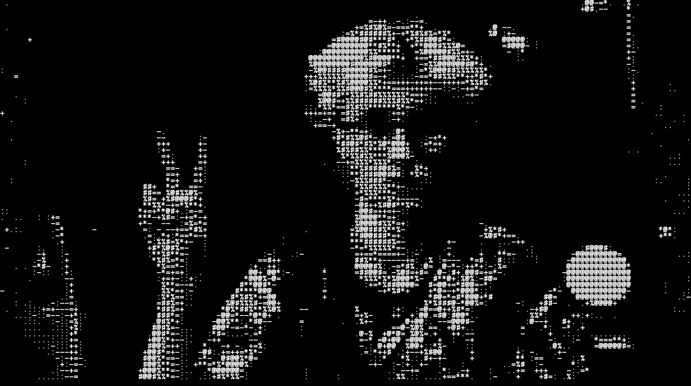

<picture><source media="(prefers-color-scheme: dark)" srcset="docs/media/visor-logo-white.svg"><source media="(prefers-color-scheme: light)" srcset="docs/media/visor-logo-dark.svg"></picture>

<h1 align="center">ASCII ⛶ VISOR · OBS Edition</h1>

<b>在 <a href="https://obsproject.com/">OBS Studio</a> 中，将摄像头和视频实时变成字符艺术。</b>

基于 ASCII ⛶ VISOR 5.0 开发 · 作者： <a href="https://github.com/TRIPCHILLER">TRIPCHILLER</a>

<a href="README.md"> English</a> · <a href="README.ru.md"> Русский</a> · <a href="README.es.md"> Español</a> · <a href="README.pt-BR.md"> Português (Brasil)</a> · <a href="README.de.md"> Deutsch</a> · <a href="README.fr.md"> Français</a> · <a href="README.ja.md"> 日本語</a> · <a href="README.ko.md"> 한국어</a> · <b> 简体中文</b> · <a href="README.zh-TW.md"> 繁體中文</a>

<b>Windows · Linux · macOS</b>

 &nbsp;  &nbsp; 

<a href="docs/INSTALL.en.md">安装</a> · <a href="#examples">示例</a> · <a href="https://github.com/TRIPCHILLER/ascii-visor-obs/issues/new/choose">报告问题</a> · <a href="https://github.com/TRIPCHILLER/ascii-visor-obs/releases">版本发布</a>

**ASCII ⛶ VISOR** 是 [OBS Studio](https://obsproject.com/) 的视频滤镜插件，可将摄像头或其他视频源实时转换成 ASCII 图像。选择字符、调整颜色和密度，让画面融入你的场景。效果会立即显示在预览中，并应用于录制或直播。

适用于个性化摄像头画面、创意直播、音乐演出和视频实验。

ASCII 头像也是一种类似 VTuber 的出镜方式：用风格化形象代替普通摄像头画面，同时保留实时动作和反应。它能提供一定的视觉隐私，但不保证匿名性：声音、轮廓和画面细节仍可能让人认出你。

## ✨ 主要功能

| 功能 | 用途 |
|---|---|
| **8种预设字符集** | 使用经典 ASCII、其他字符和几何图形改变画面质感。 |
| **自定义字符** | 输入自己的字符集，创造独特风格。 |
| **20种配色方案** | 选择预设风格或调整自己的颜色。 |
| **保存配色风格** | 每个滤镜最多保存20个自定义配色预设。 |
| **透明背景** | 让字符间隙透明，将画面叠加在游戏或视频上。 |
| **图像调整** | 调整密度、对比度、伽马、黑白电平、缩放和位置。 |
| **直接在 OBS 中使用** | 通过标准滤镜面板调整，并用于录制和直播。 |

密度范围为**横向30到150个字符**。字符集与配色方案可独立选择、自由组合。

### 🎨 配色风格

同一个视频源，也能呈现不同氛围。切换配色方案，或自行选择字符和背景颜色。

https://github.com/user-attachments/assets/30c21fb0-9aad-4652-9b45-b2c97a04a234

### 🔤 字符集与自定义输入

保持喜欢的配色，从**8种预设字符集**中选择。经典 ASCII、其他字母、数字和几何图形都有各自独特的质感。

https://github.com/user-attachments/assets/8ed8da50-d899-492f-a81a-4ccff01a9210

想做出自己的风格？选择**自定义输入**，输入想使用的字符。尝试不同组合，找到喜欢的效果。

https://github.com/user-attachments/assets/067aa13c-cada-4ff3-859d-4025b0b72c82

### 🎛️ 实时调整

根据光线和场景中的摄像头画面大小调整密度与色调。修改会立即显示在预览中。

https://github.com/user-attachments/assets/772cb41e-769f-432c-b734-f8f910bb3957

### 🫧 适合场景的透明背景

启用透明背景后，字符间隙可显示游戏、视频或其他场景源。将 ASCII 摄像头画面融入直播布局。

透明的是字符之间的空隙，并不会自动把人物与房间背景分离。

https://github.com/user-attachments/assets/7efa18ca-853b-4c0f-a8cb-d59d1732bf57

## 🚀 快速开始

在上方选择系统，关闭 OBS 并运行安装程序。随后打开 OBS，选择视频源并按以下顺序操作：**在预览中右键点击所选源的画面 → 滤镜 → +（加号图标）→ ASCII ⛶ VISOR**。

[安装指南](docs/INSTALL.en.md) · [Releases](https://github.com/TRIPCHILLER/ascii-visor-obs/releases/tag/v0.3.1-rc1)

https://github.com/user-attachments/assets/6e653001-9286-4655-aad6-fa029b3f2180

手动安装和其他压缩包

- [ASCII-VISOR-0.3.1-rc1-Windows-x64-Plugin.zip](https://github.com/TRIPCHILLER/ascii-visor-obs/releases/download/v0.3.1-rc1/ASCII-VISOR-0.3.1-rc1-Windows-x64-Plugin.zip)
- [ASCII-VISOR-0.3.1-rc1-Linux-x86_64-Plugin.tar.gz](https://github.com/TRIPCHILLER/ascii-visor-obs/releases/download/v0.3.1-rc1/ASCII-VISOR-0.3.1-rc1-Linux-x86_64-Plugin.tar.gz)
- [ASCII-VISOR-0.3.1-rc1-macOS-universal-Plugin.zip](https://github.com/TRIPCHILLER/ascii-visor-obs/releases/download/v0.3.1-rc1/ASCII-VISOR-0.3.1-rc1-macOS-universal-Plugin.zip)
- [ASCII-VISOR-0.3.1-rc1-Linux-x86_64-Setup.tar.gz](https://github.com/TRIPCHILLER/ascii-visor-obs/releases/download/v0.3.1-rc1/ASCII-VISOR-0.3.1-rc1-Linux-x86_64-Setup.tar.gz)
- [SHA256SUMS.txt](https://github.com/TRIPCHILLER/ascii-visor-obs/releases/download/v0.3.1-rc1/SHA256SUMS.txt)
- Source code: GitHub ZIP / TAR.GZ

## 帮助

找不到滤镜？

请完全重启 OBS 并选择视频源，然后按以下顺序操作：**在预览中右键点击所选源的画面 → 滤镜 → +（加号图标）→ ASCII ⛶ VISOR**。 如果列表中没有 ASCII VISOR，请[报告问题](https://github.com/TRIPCHILLER/ascii-visor-obs/issues/new/choose)并提供操作系统和 OBS 版本。

更新插件

关闭 OBS，通过对应系统的按钮下载最新安装程序，并选择原来的安装位置。**无需卸载旧版本：**新版本会直接覆盖并更新插件文件。OBS 的场景和配置文件会保留。

如何删除插件？

关闭 OBS，按照[对应系统的安装指南](docs/INSTALL.en.md)中的删除步骤操作。只删除插件，OBS 本体及其设置会保留。

## 🌍 10种界面语言

插件和安装程序支持以下语言。插件跟随 OBS 的语言，修改后请重启 OBS。安装程序语言可以单独选择。

| | 语言 | 区域代码 |
|---|---|---|
|  **US** | English | `en-US` |
|  **RU** | Русский | `ru-RU` |
|  **ES** | Español | `es-ES` |
|  **BR** | Português (Brasil) | `pt-BR` |
|  **DE** | Deutsch | `de-DE` |
|  **FR** | Français | `fr-FR` |
|  **JP** | 日本語 | `ja-JP` |
|  **KR** | 한국어 | `ko-KR` |
|  **CN** | 简体中文 | `zh-CN` |
|  **TW** | 繁體中文 | `zh-TW` |

使用页面顶部的链接切换本文语言。

## 💻 兼容性

Windows x64；Linux x86_64（Ubuntu 24.04 / glibc 2.39 或更新版本）；macOS universal（Apple Silicon 和 Intel）。需单独安装 OBS。使用 OBS 32.2.2 测试。macOS 使用临时签名，未经 Apple 公证。Linux Flatpak 需要兼容的 OBS 运行环境。详情参见指南。

[安装指南](docs/INSTALL.en.md)

## ☕ 支持项目

ASCII ⛶ VISOR · OBS Edition 是**免费开源插件**，所有功能均无需付费。

喜欢这个插件？可以[在 Boosty 支持 TRIPCHILLER](https://boosty.to/tripchiller)，帮助推出更新和新的创意项目。

## 🛠️ 开发者指南

编译说明和翻译检查：[BUILD.md](BUILD.md)。

## 💬 建议与反馈

有新点子或发现问题？选择相应表单，描述建议或遇到的情况。我们可以集中讨论，并在解决后告知你。

**[💡 提出建议或报告问题](https://github.com/TRIPCHILLER/ascii-visor-obs/issues/new/choose)**

提交需要 [GitHub](https://github.com/) 账号。插件**关于项目**中的**建议与问题反馈**按钮也会打开同一页面。

## 📄 许可证

插件：**GPL-2.0-or-later**。字体：**SIL Open Font License / M+**。参见 [LICENSE](LICENSE) 和 [THIRD_PARTY.md](THIRD_PARTY.md)。

ASCII ⛶ VISOR · OBS Edition 是 [TRIPCHILLER](https://github.com/TRIPCHILLER) 开发的独立社区项目，并非 OBS Project 官方产品。
